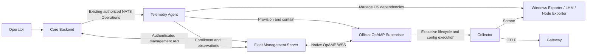

# Fleet Management architecture overview

**Status:** B+ architecture ACCEPTED; wire details retain the status in the canonical contracts.
**Audience:** Fleet, Core and Agent developers. **Target:** v0.1.4a-next.
This is a navigation and ownership summary, not another contract.
[Canonical contract index](../../contracts/fleet-management/README.md).

## Accepted B+ decisions

Core is the public control entrypoint and business authorizer. Fleet Management
Server is the separate AR-IMMS Go service using opamp-go; it owns fleet enrollment,
credentials, desired Collector configuration, revisions, publications, sessions,
observed outcomes and fleet execution audit. The official OpenTelemetry OpAMP
Supervisor v0.160.0 is a different product on the managed host.

| Component | Authority and responsibility |
|---|---|
| Core Backend | IAM, Node/Asset binding, business authorization and business audit; existing Core-authorized NATS Operations |
| Fleet Management Server | Fleet registration and credential authority; desired policy, revision/CAS, durable publication and observed execution history |
| Official OpAMP Supervisor | Native OpAMP client; sole Collector lifecycle and configuration executor in Fleet-managed native mode; supported fallback and rollback |
| Collector | Receivers, processors, exporters, scraping and OTLP delivery |
| Telemetry Agent | Installation, stable identity, environment evidence, protected credentials, Supervisor provisioning, OS exporters, CLI, diagnostics and infrastructure Operations |

Use upstream OTel components before custom telemetry execution. Do not implement
Supervisor behavior inside Fleet or Agent. Fleet and Core own separate persistence;
neither accesses the other's database repositories. Core business audit and Fleet
execution audit correlate by operation IDs.

## Accepted identity principles

Reuse the persisted installation UUID as agent_id. Keep it stable across restart
and upgrade; never derive it from hostname, machine fingerprint or session.
host_id is optional OS-derived evidence, never an authentication credential or
proof of physical placement. Hostname is mutable metadata.

Keep compute_type (BARE_METAL / VM / UNKNOWN), orchestrator
(NONE / KUBERNETES / UNKNOWN), and deployment_scope
(HOST_SERVICE / K8S_NODE_AGENT / K8S_POD / UNKNOWN) independent.
host_type is a derived presentation category. A Kubernetes node can itself be
a VM or bare metal; Kubernetes environment variables alone do not prove node scope.
Include OS, architecture, inspected versions, timestamps and provenance. Missing
or conflicting evidence stays UNKNOWN.

Duplicate host fingerprints never automatically merge installations. Copied
installation state/credentials require explicit collision handling. Core owns
confirmed business topology; Agent/Fleet evidence cannot silently establish it.
Supervisor instance_uid is a protocol identity bound to an authenticated
installation, not a credential; its exact mapping remains OPEN.

See [C01](../../contracts/fleet-management/enrollment-identity-v1.md) and
[C03](../../contracts/fleet-management/inventory-health-v1.md) for canonical rules.

## Migration and evidence

Preserve three distinguishable states: legacy Agent-managed Collector,
current Core-backed Supervisor-managed Collector, and target Fleet-backed
Supervisor-managed Collector. Supervisor.Enabled selects lifecycle ownership,
not configuration authority. Keep current writers operational until approved
Fleet composition, enrollment and migration prerequisites pass. Exactly one
Collector lifecycle owner may run per installation.

Agent-managed Windows Exporter, Libre Hardware Monitor and Node Exporter,
CLI compatibility, SQLite history, protected secrets and Operations safety remain
required. Dependency teardown must respect live/fallback configuration references.

**Mock Fleet: PASS** for the recorded provisional Agent integration tests.
**Production Fleet/NestJS integration: NOT VERIFIED.** This is not a claim that
a production Fleet service exists or that draft APIs conform.
See the [verification matrix](../../integration/fleet-management/verification-matrix.md).

## Proposed and open work

PROPOSED payloads and endpoints require owner approval. OPEN items include auth
scope/rotation, UID mapping, composition/component ownership, migration, retry and
retention policy. Resolve them in C01–C04, not in this overview. Remote package
updates and OpAMP Collector restart commands are deferred baseline capabilities.
