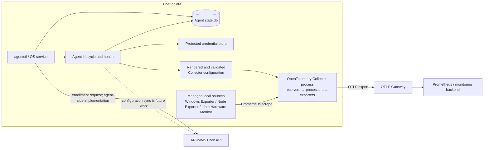

# Telemetry Agent Architecture Overview

**Status:** Implementation overview for the AR-IMMS Telemetry Agent. Current-code status below was checked on 30 October 2026. Target responsibilities refer to the accepted Agent architecture v0.1.4 document in the Agent repository; that local design document is maintained separately from this shared repository.

## Purpose and boundary

The Telemetry Agent is installed on a Windows or Linux host or VM. It manages local configuration and dependency lifecycle, supervises an OpenTelemetry Collector process, and provides telemetry to the OTLP Gateway. The Collector remains the telemetry engine: it scrapes configured sources, processes signals, and exports them. Core owns fleet-level desired configuration after an installation is enrolled; the Agent owns local state and runtime application.

## Runtime flow

The Collector's receivers, processors, and exporters form its configured pipeline. It is separate from the Agent process. Host sources may also be collected through Collector-native receivers. Exporters managed by the Agent expose local endpoints and are scraped by Collector; they do not send directly to the Gateway.

## Responsibilities and implementation status

| Target responsibility | Current implementation in the Agent repository | Status / boundary |
|---|---|---|
| Lifecycle host | `agentctl` commands, Windows Service and Linux systemd support, bootstrap, and Collector supervision | Implemented. CLI composition wires the operational flows. |
| Installation identity | Stable per-installation UUID persisted through SQLite | Implemented. It is local identity; it is not a credential. |
| Enrollment and connectivity | `agentctl enroll`, durable attempt state, HTTPS enrollment client, and OS-protected credential storage | Agent-side flow implemented. Real Core endpoint compatibility, authorization behavior, and lost-response recovery remain unverified until tested against Core. Enrollment does not change Gateway configuration or start/restart Collector. |
| Core configuration synchronization | Local Gateway snapshot validation, ownership/revision persistence, generation association, and runtime activation support exist | Partial. Authenticated polling from Core and the Core snapshot endpoint are not implemented here. |
| Configuration and activation | Deterministic Collector config rendering/validation, desired/activated/applied generations, last-known-good recovery, and generation-bound Collector readiness | Implemented for current local configuration and Gateway endpoint lifecycle. It is not yet a general-purpose configuration compiler for arbitrary integrations. |
| Resource discovery and inventory | Platform checks and inspection of explicitly managed dependencies | Partial. There is no general host/VM/service inventory with provider registry and freshness model. |
| Integration management | Built-in dependency catalog and lifecycle adapters for Windows Exporter, Node Exporter, and Libre Hardware Monitor | Partial. The general Integration Definition / Instance extension model and Redis, PostgreSQL, MongoDB, and application integrations remain future work. |
| Reconciliation | Idempotent dependency lifecycle operations and configuration generation application | Partial. A generic reconciler over desired, discovered, and applied integration snapshots is not implemented. |
| Collector runtime control | Pinned Collector installation, configuration validation, process supervision, restart, and readiness observation | Implemented for the current distribution and configured components. New Collector factories still require a distribution build. |
| Health and diagnostics | Local health snapshot and status command, including Collector runtime state | Partial. Independent probe/evidence contracts, `HealthChanged` event publication, and policy evaluation are not complete. |
| Persistence and infrastructure | SQLite operational state, filesystem/process/platform adapters, and separate credential storage | Implemented for current Agent state. A durable latest-status outbox and Core reporting delivery are not yet implemented. |
| OpenTelemetry data plane | Separate Collector process with configured receivers, processors, and exporters | Implemented. The exact shipped capability set depends on the pinned distribution/build. |

“Partial” means the current code provides a narrower concrete capability, not that the target subsystem is complete. The accepted target architecture remains the design authority for future changes.

## Enrollment boundary

The Agent-side enrollment path uses the existing installation UUID. It writes a secret-free attempt record and stores the bootstrap token in the protected credential store before sending the request. Retries and `agentctl enroll --resume` reuse the durable attempt ID and payload. A successful validated response commits the local binding and credential reference. The bootstrap token is removed after that commit.

The request contract and route implemented by the Agent still need end-to-end verification against the Core service. In particular, Core must authorize the presented bootstrap credential against its registration/installation binding, reject revoked registrations, and define how a repeated attempt recovers an issued credential after a lost response. Until those Core-side behaviors are verified, enrollment is not considered production-validated. Enrollment does not activate telemetry configuration.

## State and safety boundaries

- SQLite is the durable source for Agent operational state and revisions. Credential values are stored outside SQLite using the platform credential adapter.
- Desired, activated, and applied configuration generations are distinct. A configuration is reported applied only after the selected Collector generation passes readiness.
- The Collector runtime adapter owns process operations. Dependency-specific code does not directly control the Collector process.
- Core outages must not stop an already running Collector. After Core-managed configuration has been accepted, local operation uses persisted state and the last successfully activated configuration.
- Health reports observations. Configuration lifecycle policy owns activation and rollback decisions.

## Current verification and next boundaries

The Agent repository has unit and SQLite persistence tests, and Windows/Linux builds can validate platform compilation. Those checks do not establish Core API compatibility. The enrollment flow still needs an integration run against the actual Core service, including authorization, revoked binding, duplicate-attempt retry after a lost response, and the issued credential contract.

Work that can proceed before Core is available includes platform credential-store runtime tests, Collector activation and restart-recovery tests using a local/mock runtime, and Agent-side discovery/integration slices that use existing Collector capabilities. Core polling, authenticated status reporting, server-side credential recovery, and end-to-end registration acceptance must wait for a verified Core contract or test environment.
