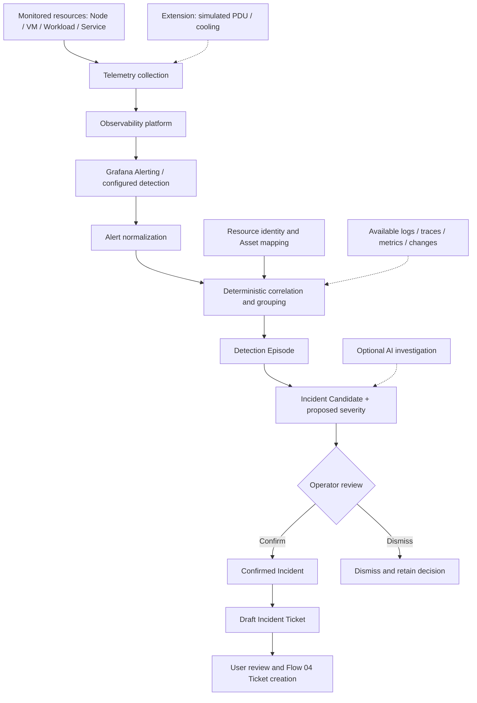
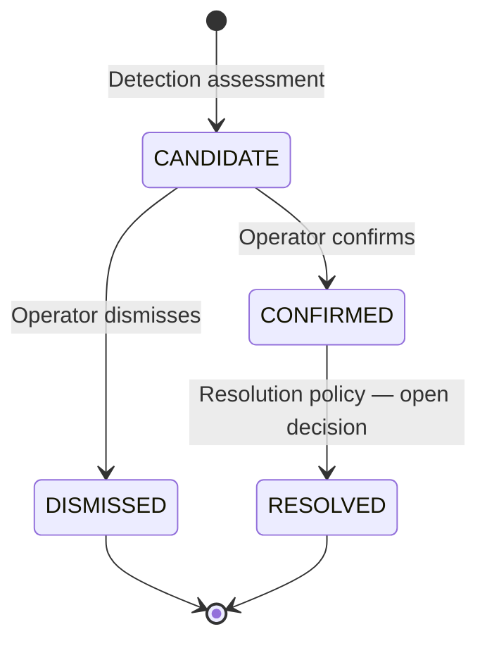

# Business Flow 03 — Monitoring & Anomaly Detection

> **Document type:** Shared business-flow baseline  
> **Status:** Accepted direction — draft for document review  
> **Domain:** Monitoring, Detection & Incident Identification  
> **Primary actor:** System Monitoring Operator  
> **Related flows:** Flow 01 — Infrastructure Asset Management; Flow 02 — Agent Registration & Management; Flow 04 — Ticket Management; Flow 05 — Incident-driven Maintenance & AI/AR Support

## 1. Purpose and business outcomes

AR-IMMS shall allow an Operator to observe monitored resources, distinguish unavailable monitoring data from an observed operational fault, detect actionable conditions, and relate signals to an incident requiring human assessment. The flow connects monitoring to incident identification and, where appropriate, a **Draft Incident Ticket** for Flow 04.

The PoC monitors selected **Nodes/VMs** and **Workloads/Services**. Its design must also allow additional source classes such as **PDU, power, cooling, and environmental sensors** without redesigning the downstream alert-to-incident workflow. Supporting every source class or physical device is **not** a PoC commitment.

Business outcomes:

1. Operators can review monitoring data and identify the associated monitored resource and, when known, its registered Asset.
2. Monitoring-data freshness/completeness is not confused with the actual health of hardware or services.
3. Detected signals can be normalized, grouped, assessed and reviewed without automatically generating one Incident per Alert.
4. An Operator can confirm or dismiss an Incident Candidate and review its evidence, affected resources and severity.
5. A Confirmed Incident can lead to a user-reviewed Draft Incident Ticket; Ticket creation and lifecycle remain in Flow 04.
6. Adding a telemetry source and its detection configuration does not require a new incident model or a source-specific ticket workflow.

## 2. Scope and boundaries

### In scope — baseline PoC

- Observe selected Node, VM, Workload and Service telemetry; provide navigable context by resource and associated Asset where a verified mapping exists.
- Expose monitoring-data freshness and completeness, with rules appropriate to the monitored source; treat missing data distinctly from a confirmed operational failure.
- Evaluate configured detection rules through **Grafana Alerting** and accept resulting alerts as detection signals.
- Normalize alerts to a common monitoring event representation, retaining source and identity information.
- Correlate related signals using deterministic baseline criteria such as time proximity, resource identity and known relationships; form a **Detection Episode** when appropriate.
- Assess potential Incidents, present Incident Candidates for Operator review, and preserve the decision and relevant evidence.
- Derive an **initial Incident severity from contributing Alert severity**, allowing an authorized Operator to adjust it with traceability.
- Identify potentially affected resources and provide available context from logs, traces, metrics and changes without requiring every signal type for every case.
- Prepare a Draft Incident Ticket only for a Confirmed Incident, subject to user review before an actual Ticket is created through Flow 04.

### Extension demonstration

- Show **one simulated additional resource class**, preferably a PDU/power source or alternatively cooling, publishing telemetry through a supported adapter/exporter and using the **same** normalization, detection, correlation and incident workflow.
- Document what changed upstream (source adapter, resource identity/mapping, alert rule) and what stayed unchanged downstream.

### Out of scope

- Universal support for all infrastructure devices, hardware fault diagnosis, or production-scale monitoring guarantees.
- An independent alert-rule evaluator duplicating Grafana Alerting.
- A dedicated incident pipeline or ticketing implementation for each resource type.
- Direct Asset/Topology mutation, Agent enrollment/configuration, Ticket lifecycle, Maintenance execution, or automatic remediation.
- Autonomous AI confirmation, Incident closure or operational actions.
- A generic dynamic plugin framework, universal resource schema, or source-specific detector for every possible asset class in the initial PoC.

## 3. Participants and ownership

| Participant / subsystem | Responsibility |
| --- | --- |
| **System Monitoring Operator** | Reviews monitoring conditions and Incident Candidates; confirms/dismisses candidates; may adjust Incident severity when authorized; initiates draft-ticket review. |
| **IT Admin** | Manages permitted monitoring configuration/integrations and supporting resource/asset setup according to IAM permissions. |
| **Telemetry Agent / OTel Collector** | Collects and forwards available telemetry; Agent control-plane readiness is distinct from telemetry health. |
| **Observability Platform** | Receives, stores and serves telemetry (metrics, logs and traces); Grafana Alerting evaluates configured alert rules. |
| **Resource Discovery & Inventory** | Supplies identities and observations for logical/externally monitored resources; mapping to physical Assets is explicit and may be unknown. |
| **Asset & Topology (Flow 01)** | Source of truth for registered physical Asset identity and confirmed location. |
| **Monitoring / Detection** | Normalizes signals, groups evidence and provides deterministic correlation and detection-episode context. |
| **Incident Management** | Records candidate decisions, confirmed incidents, severity, evidence and affected-resource context. |
| **AI Investigation** | Optional evidence-based suggestions; cannot replace Operator confirmation or authorize remediation. |
| **Ticket Management (Flow 04)** | Owns actual Ticket creation/lifecycle and business links; Zammad remains the Ticket source of truth. |

A monitored resource does **not** have to be registered as a physical Asset in Flow 01. Asset identity and resource identity must not be conflated; unknown mappings are shown as unknown rather than guessed from a hostname, address or label.

## 4. Terminology

| Term | Meaning in this flow |
| --- | --- |
| **Monitored Resource** | An identifiable Node, VM, Workload, Service or other monitored source such as a simulated PDU. |
| **Alert** | Detection signal raised by an alerting source when a configured condition is met; not itself an Incident or Ticket. |
| **Detection Episode** | A logical grouping of related monitoring signals and context; does not by itself require a separate database collection or approval step. |
| **Incident Candidate** | A potential incident requiring evaluation, not yet confirmed by an Operator. |
| **Confirmed Incident** | An incident accepted by an authorized Operator for investigation/tracking. |
| **Incident severity** | Business-level assessment of Incident importance; initially derived from the severity of contributing Alerts and subject to an authorized, audited Operator override. |
| **Affected Resource** | A resource potentially impacted by the condition, with its identity and evidence/relationship where available. |
| **Draft Incident Ticket** | A proposed Ticket assembled from a Confirmed Incident; not yet a Ticket in Zammad. |

## 5. Main business workflow

1. The monitoring sources supply telemetry through supported collection paths to the Observability Platform.
2. Monitoring views show telemetry for identifiable resources and indicate freshness/completeness according to applicable monitoring rules.
3. Configured Grafana Alerting rules produce Alerts; Operators/Admins may add rules through the authorized configuration process.
4. Monitoring/Detection normalizes alerts and associates available resource identity, source, timestamps and alert severity.
5. The system correlates related signals using known context and deterministic rules; an Episode may contain one or multiple Alerts.
6. When the episode warrants review, Incident Management presents an Incident Candidate with supporting evidence, suggested affected resources and **proposed Incident severity based on its contributing Alerts**.
7. The Operator reviews the Candidate and confirms or dismisses it. An authorized Operator can adjust severity; the original proposal and change are traceable.
8. After confirmation, the Operator may review a Draft Incident Ticket and explicitly request Ticket creation through Flow 04. Ticket creation is not a side effect of an Alert or unconfirmed Candidate.

## 6. Business rules and invariants

| ID | Rule |
| --- | --- |
| **F3-BR-01** | Monitoring shall preserve the distinction between **observed failure/degradation** and **missing, stale or incomplete telemetry**. No-data alone does not prove a hardware or service failure. |
| **F3-BR-02** | Each normalized Alert shall preserve its source identity, timestamps, relevant resource reference, alert condition/status and source severity where available. Missing or ambiguous identity must not be silently assigned to a physical Asset. |
| **F3-BR-03** | Alert evaluation is owned by Grafana Alerting for the baseline; rules may be curated/extended by an authorized Operator/Admin. Core shall not reimplement a competing rule engine. |
| **F3-BR-04** | Related Alerts may be grouped into a Detection Episode using deterministic, explainable criteria. A one-to-one Alert → Episode → Incident mapping is not mandatory. |
| **F3-BR-05** | Incident Candidates require explicit authorized Operator confirmation or dismissal; AI suggestions do not automatically confirm them. |
| **F3-BR-06** | **Initial Incident severity shall be derived from the severity of contributing Alerts using a documented, deterministic mapping/aggregation policy.** The proposed severity and its supporting Alerts shall be visible to the Operator. An authorized Operator may override Incident severity with a recorded actor, time and reason. Incident severity is not the same stored field as the severity of an individual Alert. |
| **F3-BR-07** | Logs, traces, metrics, change records and historical patterns can enrich investigation when available; absence of a specific signal type does not automatically block Incident evaluation. |
| **F3-BR-08** | The system shall associate an Incident with identifiable affected resources and distinguish **confirmed mappings** from **inferred/potential impact**. The registered physical Asset identity/location, when referenced, comes from Flow 01. |
| **F3-BR-09** | A Draft Incident Ticket may be proposed only for a Confirmed Incident. Creating the actual Ticket requires an explicit authorized user action through Flow 04; no Alert automatically creates a Zammad Ticket. |
| **F3-BR-10** | A new telemetry source/resource class shall be integrated via suitable collection, resource identification and alert configuration while reusing the common downstream detection-to-incident process. |
| **F3-BR-11** | Monitoring and Incident Management do not directly change Asset lifecycle, Agent binding, Ticket status or Maintenance Activity state. |
| **F3-BR-12** | Significant Operator decisions, Incident severity overrides and Ticket initiation shall be traceable through the agreed Audit mechanism. |

**Severity policy note:** For multiple contributing Alerts, the exact aggregation rule (for example, highest mapped Alert severity versus a contextual policy) and the severity vocabulary must be specified in the technical/operational configuration before implementation. This business flow fixes the **input, ownership, transparency and override behavior**, not an unapproved algorithm.

## 7. Alternative and exception flows

| Condition | Expected business behavior |
| --- | --- |
| Telemetry is late, absent or incomplete | Show data-availability/coverage state; do not assert the resource has failed solely because data is missing. An explicit telemetry-loss alert may still warrant review. |
| Alert has no reliable resource mapping | Retain source identity and available evidence; flag association as unresolved rather than fabricate a physical Asset link. |
| Multiple Alerts describe one likely underlying issue | Correlate when deterministic evidence supports the relationship; avoid automatic duplicate Incident creation as a default behavior. |
| Signals have insufficient or conflicting context | Keep an explainable Candidate/uncertainty indication or require Operator review; do not claim verified root cause. |
| Logs or traces are unavailable | Continue with available Alerts/resource information where sufficient; show missing evidence rather than inventing it. |
| Operator dismisses Candidate | Preserve decision and reason/history as appropriate; do not create a Ticket. |
| Operator adjusts severity | Preserve proposed and effective severity, actor, time and justification. |
| Zammad / Flow 04 is unavailable | Keep the Confirmed Incident and draft context; report Ticket creation failure, without claiming a Ticket exists. |
| New source is unsupported | Require an adapter/exporter and identity/alert configuration; no change to the Incident domain model solely because a new type is added. |
| Simulated source disappears | Treat missing telemetry according to source freshness rules; do not infer physical failure or silently delete the Incident history. |

## 8. Acceptance criteria

| ID | Acceptance criterion |
| --- | --- |
| **F3-AC-01** | Operator can review selected Node/VM and Workload/Service telemetry with identifiable resource context. |
| **F3-AC-02** | Monitoring views distinguish fresh, incomplete and unavailable data from observed operational conditions. |
| **F3-AC-03** | An authorized configured rule produces an Alert that reaches the common normalization process with source and resource information preserved. |
| **F3-AC-04** | Related Alerts can be grouped and their grouping rationale inspected; unrelated Alerts are not forced into one Episode. |
| **F3-AC-05** | An Incident Candidate can be confirmed or dismissed by an authorized Operator; both outcomes are traceable. |
| **F3-AC-06** | The Candidate's initial Incident severity is deterministically derived from contributing Alert severity and displayed with its basis; an authorized Operator override updates effective Incident severity and leaves an audit trail. |
| **F3-AC-07** | An Incident can reference verified affected resources and indicate uncertainty for inferred/unknown mapping. |
| **F3-AC-08** | A Confirmed Incident can produce a user-reviewed Draft Incident Ticket; no Ticket is created before explicit authorization in Flow 04. |
| **F3-AC-09** | Detection/Incident handling still functions for a supported scenario when one optional evidence type (such as traces) is absent. |
| **F3-AC-10** | One additional **simulated** source class (PDU/power or cooling) can produce a detectable condition and Candidate using the existing downstream pipeline without a new incident schema/workflow. |
| **F3-AC-11** | A telemetry outage is not presented as verified device failure, and a missing Asset mapping is not silently fabricated. |
| **F3-AC-12** | AI may suggest investigation findings but cannot confirm an Incident or execute an operational action without the owning business process. |

## 9. Candidate demonstration scenarios

| Scenario | Business outcome |
| --- | --- |
| Host or VM telemetry interruption | Distinguish monitoring-data loss from verified failure; present stale/missing coverage. |
| API/service error rate increase | Detect service degradation and identify the affected logical resource. |
| PostgreSQL saturation | Relate database Alert context to dependent services using available relationships/evidence. |
| Multiple correlated Alerts | Group likely related signals and reduce duplicate Incident candidates. |
| Simulated PDU power overload **or** simulated cooling anomaly | Demonstrate a new source class through the shared pipeline. |

These are candidate demo scenarios; final fault injection, ground truth and scoring belong to an evaluation/demo plan, not to the business flow itself.

## 10. Incident state model — proposed boundary

`CANDIDATE`, `CONFIRMED`, `DISMISSED` and `RESOLVED` describe proposed business stages, **not** a claim that all are persisted Incident states or that a separate Incident Candidate collection is required. In particular, who may resolve an Incident, required verification and any relationship to Ticket/Maintenance closure are **not yet approved**. No automatic close rule is implied.

## 11. Cross-flow integration

- **Flow 01 — Asset & Topology:** Provides canonical registered Asset identity and confirmed physical placement. Monitored Workloads/Services and external/simulated resources need not be registered as physical Assets.
- **Flow 02 — Agent Management:** Owns enrollment, desired configuration, Agent status and inventory integration. Registration, Collector readiness, telemetry freshness and resource health remain distinct.
- **Flow 04 — Ticket Management:** Owns actual Ticket records, assignment, status and articles via Zammad; a Draft Incident Ticket remains advisory until user-confirmed creation.
- **Flow 05 — Maintenance:** Owns assigned work, physical verification, execution and recovery checks. A Ticket or Incident state transition alone does not modify Asset maintenance state.
- **AI Investigation:** Optional analysis and recommendations using available evidence; final decisions stay with authorized users.

## 12. Open decisions and deferred technical details

| ID | Topic | Status / boundary |
| --- | --- | 
| **OD-01** | Incident confirmation authority | **Accepted:** authorized Operator confirms/dismisses. |
| **OD-02** | Detection Episode | **Accepted:** logical correlation grouping; separate persistence optional. |
| **OD-03** | Baseline correlation | **Accepted:** deterministic, explainable rules; AI optional. |
| **OD-04** | Logs/traces availability | **Accepted:** enrichment as available, not mandatory per Incident. |
| **OD-05** | Incident severity | **Accepted:** proposed from contributing Alert severity; authorized Operator may adjust with traceable rationale. **Technical policy pending:** vocabulary, mapping and multi-Alert aggregation. |
| **OD-06** | Draft Incident Ticket | **Accepted:** after Confirmed Incident, explicit user review before Flow 04 creation. |
| **OD-07** | Monitoring-data loss | **Accepted:** data absence != verified resource failure. |
| **OD-08** | Monitored resource identity | **Accepted:** not every monitored resource is a Flow 01 Asset. |
| **OD-09** | Extensibility | **Accepted:** common downstream pipeline, source-specific upstream adapters/rules. |
| **OD-10** | AI role | **Accepted:** analysis/suggestions only. |
| **OD-11** | Incident resolution/closure | **Open:** ownership, verification, relationship to Flow 04/05. |
| **OD-12** | Resource mapping and correlation contracts | **Pending technical design:** schemas, exact identity keys, time windows, alert deduplication/idempotency. |
| **OD-13** | Simulation selection | **Open for implementation plan:** PDU/power or cooling; only one required for extensibility demo. |

**Documentation policy:** This file specifies the cross-team business behavior. Exact OTLP schemas, metric names, alert labels, Grafana configuration, API payloads, data persistence, detector algorithms and concrete deployment belong to the corresponding architecture, contract, integration and repository-local documentation. Proposed technical choices must not be presented as verified source implementation.
