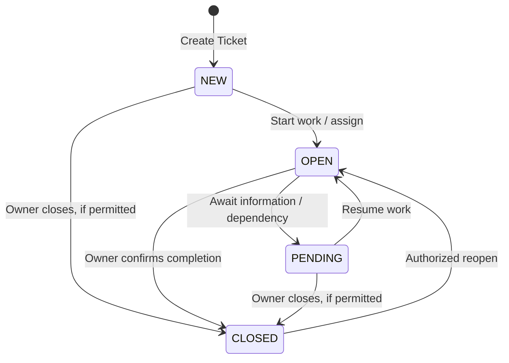

# Business Flow 04 — Ticket Management

**Status:** Accepted business baseline (2026-11-08); integration details pending verification  
**Domain:** Ticket Management  
**Primary actors:** System Monitoring Operator, Ticket Owner, Maintenance Technician  
**Related flows:** Flow 01 — Infrastructure Asset Management; Flow 03 — Monitoring & Anomaly Detection; Flow 05 — Incident-driven Maintenance & AI/AR Support

## 1. Purpose

Enable authorized users to create, assign, track, update, close, and reopen operational Tickets through AR-IMMS. Tickets coordinate follow-up work, including but not limited to incidents and field maintenance. AR-IMMS uses **Zammad as the source of truth for ticket records, lifecycle, assignment, and articles**, while AR-IMMS Core owns authorization at its API boundary and AR-IMMS-specific business context and links.

This document specifies business behavior and domain ownership. It does not prescribe database schemas, Zammad endpoint mappings, or implementation classes.

## 2. Expected outcomes

- An Operator or authorized IT Admin can create a Ticket manually, whether or not an Incident exists.
- A confirmed Incident can lead to a **Draft Incident Ticket** for review before Ticket creation.
- An authorized user can assign or reassign a Ticket and follow its progress.
- The Ticket Owner is responsible for final closure; an Assignee carries out assigned work.
- Authorized users can reopen a closed Ticket for additional work.
- Tickets can reference Incidents, Assets, and Maintenance Activities without transferring ownership of those domains.
- Ticket articles and canonical status stay in Zammad; AR-IMMS presents a unified user experience.

## 3. Scope and boundaries

### In scope

- Manual Ticket creation and creation from a reviewed incident-driven draft.
- Ticket details, priority, lifecycle status, assignment, and articles through AR-IMMS.
- Owner and Assignee responsibilities, permission checks, close, and reopen.
- AR-IMMS business context and references to related Incident, Assets, and Maintenance Activities.
- Explicit handling when Zammad is unavailable, without treating a Core-only record as a successfully created Ticket.

### Out of scope

- Alert generation, anomaly detection, correlation, incident confirmation, and AI investigation (Flow 03 / AI).
- Maintenance execution, checklists, physical verification, controlled remediation, and Maintenance Records (Flow 05).
- Asset identity/placement changes (Flow 01).
- A separate ticketing engine or independent conversation store in Core.
- Telegram notification delivery as a requirement for core Ticket operations; it may be integrated separately.

## 4. Participants and responsibilities

| Participant | Responsibility |
| --- | --- |
| **System Monitoring Operator** | Review incident context, create and manage Tickets with appropriate permissions, assign/reassign, monitor progress. |
| **IT Admin** | Administer integration and permissions; may create or manage Tickets when explicitly authorized. |
| **Maintenance Technician / Assignee** | Review assigned work, update progress and relevant articles, perform maintenance through Flow 05 when applicable. |
| **Ticket Owner** | Accountable for the Ticket outcome; confirms completion and closes the Ticket. Owner is a business responsibility, not necessarily a distinct IAM system role. |
| **AR-IMMS Core** | Enforce IAM authorization, coordinate Zammad operations, manage AR-IMMS business links/context, expose Ticket functionality to clients. |
| **Zammad** | Canonical Ticket state, assignment, content/articles, and lifecycle persistence. |
| **Incident / Asset / Maintenance domains** | Own their respective records and provide references through public domain contracts. |

## 5. Ticket lifecycle

The following four statuses are the **AR-IMMS business-level lifecycle**. Exact Zammad state IDs, labels, and permitted transitions must be validated in the integration contract; this diagram does not claim native Zammad has identical state names or transition rules.

| Status | Business meaning |
| --- | --- |
| `NEW` | Ticket has been created; active handling has not started. |
| `OPEN` | Work is underway or ready for active handling. |
| `PENDING` | Work is temporarily waiting on information, a response, or a dependency. |
| `CLOSED` | The Ticket Owner has confirmed the Ticket may be closed; reopening is permitted under authorization. |

**Transition rule:** The essential baseline is `NEW → OPEN → PENDING → OPEN → CLOSED → OPEN (reopen)`. Direct closure from `NEW` or `PENDING` is **not a required business capability**; if supported, it must still pass the same Owner-only closure authorization. The integration must reject transitions that are unsupported by the effective Zammad configuration rather than silently changing states.

## 6. Business rules

**BR-01 — Source of truth.** Zammad owns canonical Ticket data, lifecycle, assignment and articles. Core does not run a parallel Ticket state machine as a second source of truth.

**BR-02 — Authorized creation.** An Operator or IT Admin can create Tickets only with the appropriate IAM permission. No Incident reference is required for manual creation.

**BR-03 — Incident-driven draft.** A confirmed Incident may lead to a Draft Incident Ticket. The draft is a reviewable proposal, **not an already created Zammad Ticket**. Ticket creation happens only after an authorized user confirms it; a raw Alert does not automatically require a Ticket.

**BR-04 — Assignment and responsibility.** An authorized Operator or ticket manager may assign/reassign a Ticket. An Assignee carries out assigned work; the Ticket Owner remains accountable for completion. Owner/Assignee are business responsibilities, not new IAM roles by default.

**BR-05 — Closure.** Only the current Ticket Owner may confirm and close a Ticket through the AR-IMMS business flow. The Core API enforces this rule before requesting the Zammad transition. Any administrative override would require a separate explicit policy decision.

**BR-06 — Reopen.** The current Ticket Owner or an Operator with ticket-management permission may reopen a closed Ticket. Reopening does not automatically restart a Maintenance Activity or change an Asset lifecycle state.

**BR-07 — Incident relationship.** A Ticket can have **zero or one primary Incident reference** in the PoC baseline, but can reference multiple Assets and relevant Maintenance Activities. Other business-link types require a concrete use case before extension. An Incident may have more than one Ticket unless a separate deduplication policy is adopted.

**BR-08 — Domain ownership.** Ticket Management stores AR-IMMS-specific business context/links only. Incident, Asset and Maintenance domains remain authoritative for their own entities. Business links must not be represented solely by message/article text.

**BR-09 — Articles.** Discussions, updates and communications use Zammad Articles; Core does not create a competing conversation store.

**BR-10 — External failure.** If Zammad cannot confirm a create or mutation request, AR-IMMS must not report success or create a false canonical Ticket in Core. Ambiguous network outcomes require reconciliation against Zammad before retrying potentially duplicative operations.

**BR-11 — Independent lifecycles.** Closing/reopening a Ticket does not, by itself, change an Asset to `ACTIVE`/`MAINTENANCE`, conclude a Maintenance Activity, or confirm/reopen an Incident.

**BR-12 — Notifications and AI.** Telegram notification is optional integration. AI may suggest content or analysis; it cannot autonomously close a Ticket or execute remediation under this baseline.

## 7. Main business flows

### 7.1 Manual Ticket creation

1. An authorized Operator or IT Admin opens Ticket creation in AR-IMMS.
2. The user enters the required Ticket information and may link an Asset or other eligible business context.
3. Core checks permissions and validates business references, then requests creation in Zammad.
4. After Zammad confirms creation, Core records or updates AR-IMMS business links referencing the canonical external Ticket ID.
5. AR-IMMS displays the Ticket. If Zammad creation is not confirmed, no successful Ticket creation is reported.

### 7.2 Incident-driven Ticket creation

1. A confirmed Incident becomes eligible for an incident-driven Ticket draft via Flow 03.
2. The user reviews the **Draft Incident Ticket**, including context and proposed description/priority.
3. An authorized user confirms creation.
4. Core creates a Ticket in Zammad and links it to the primary Incident and relevant Assets in AR-IMMS context.
5. The Ticket follows the standard lifecycle. Incident confirmation and Ticket creation remain separate operations.

### 7.3 Assign, work, and close

1. An authorized Operator or manager assigns/reassigns an Assignee and establishes or updates the Ticket Owner as permitted.
2. The Assignee reviews the Ticket and records updates through Zammad Articles.
3. The Ticket may move between `OPEN` and `PENDING` according to work progress.
4. If maintenance is required, Flow 05 manages the activity and records; Flow 04 retains the links.
5. The Ticket Owner reviews the outcome and closes the Ticket. Core validates ownership before requesting closure.

### 7.4 Reopen

1. The Owner or an Operator with management permission requests to reopen a `CLOSED` Ticket.
2. Core verifies permission and requests the transition in Zammad.
3. The Ticket returns to `OPEN`; existing articles, links, and history remain accessible.

## 8. Exceptions

| Situation | Expected behavior |
| --- | --- |
| User lacks required permission | Reject operation; do not mutate Zammad or business links. |
| Manual Ticket has no Incident | Allow creation. |
| Incident draft not confirmed | Do not create a Zammad Ticket. |
| Non-Owner attempts closure | Reject closure through AR-IMMS. |
| Unauthorized reopen/assignment | Reject requested transition. |
| Linked Incident or Asset no longer available | Preserve referential/history context where possible; do not silently rewrite another domain's records. |
| Zammad unavailable | Report failure or pending reconciliation where outcome is uncertain; do not claim success. |
| Zammad accepts Ticket but Core business-link update fails | Preserve the canonical Ticket reference and reconcile the missing link; do not create a duplicate Ticket. Exact recovery implementation belongs to integration design. |
| Unsupported Zammad status transition | Reject or surface explicit integration error; do not invent a local canonical status. |

## 9. Functional requirements and acceptance criteria

| ID | Requirement | Acceptance criteria |
| --- | --- | --- |
| F4-REQ-01 | Authorized users can create manual Tickets. | Operator/Admin with permission can create a Ticket without an Incident; unauthorized creation is rejected. |
| F4-REQ-02 | Incident-driven Ticket creation requires review. | A Draft Incident Ticket does not become a canonical Ticket until an authorized user confirms it. |
| F4-REQ-03 | Ticket lifecycle is visible and manageable. | User sees `NEW`, `OPEN`, `PENDING`, or `CLOSED` business status and authorized transitions. |
| F4-REQ-04 | Tickets support assignment/reassignment. | Authorized management action updates assignment; Assignee can view and update assigned work under permissions. |
| F4-REQ-05 | Only Ticket Owner closes the Ticket. | Owner closure succeeds; non-Owner closure through Core is rejected. |
| F4-REQ-06 | Authorized users may reopen Tickets. | Owner or authorized Operator can reopen a closed Ticket without losing history. |
| F4-REQ-07 | Tickets support business references. | A Ticket can exist without Incident, link at most one primary Incident and multiple Assets/Maintenance Activities. |
| F4-REQ-08 | Canonical Ticket data and articles remain in Zammad. | Core does not substitute independent canonical status or article persistence. |
| F4-REQ-09 | Core handles Zammad failures safely. | No false success; ambiguous outcomes and partial business-link failures are identified for reconciliation. |
| F4-REQ-10 | Ticket lifecycle does not mutate maintenance or asset lifecycle implicitly. | Closing/reopening a Ticket does not directly alter Asset state or Maintenance Activity state. |

## 10. Cross-domain ownership and integration

| Concern | Source of truth | Flow 04 usage |
| --- | --- | --- |
| Ticket, status, owner/assignee, articles | Zammad | Read/mutate through Core's integration boundary. |
| AR-IMMS Ticket business context/links | Core Ticket Management | Reference canonical Zammad Ticket ID; link domain IDs. |
| Incident and incident evidence | Incident domain | Reference confirmed Incident; prepare incident-driven draft in Flow 03. |
| Asset identity and placement | Asset & Topology | Read/reference Asset IDs; never modify placement. |
| Maintenance Activity and records | Maintenance domain | Reference Activity and outcome; Flow 05 owns execution. |
| Human authentication/authorization | Core IAM | Enforce access and workflow permissions before Zammad operations. |

`TICKET` and `TICKET_ARTICLE` in conceptual/logical diagrams must be labeled as Zammad-owned entities or representations unless implementation review establishes a justified Core-side projection. Do not infer Core owns their canonical storage from the ERD alone.

## 11. Agreed decisions and pending verification

### Accepted business decisions (OD-01–OD-08)

| ID | Decision |
| --- | --- |
| OD-01 | Operator and IT Admin may create Tickets with appropriate permissions. |
| OD-02 | Operator or another permitted ticket manager may assign/reassign. |
| OD-03 | Ticket Owner is the only business actor allowed to close through AR-IMMS. |
| OD-04 | Owner or authorized Operator may reopen. |
| OD-05 | A Ticket can have zero or one primary Incident; multiple Assets and Maintenance Activities may be linked. |
| OD-06 | Zammad outage never means a Ticket was successfully created in Core; uncertain outcomes need reconciliation. |
| OD-07 | Core retains external Ticket reference and AR-IMMS-specific context/links only; Zammad owns canonical Ticket. |
| OD-08 | Zammad Articles provide communication history; Core does not duplicate that store. |

### Integration details to verify before implementation

- Map the four business statuses to actual Zammad states and allowed transitions, including `NEW`, `PENDING`, and reopen behavior.
- Determine how Zammad represents Ticket Owner versus Assignee, and enforce the accepted Owner-only closure policy at Core's API boundary.
- Confirm user identity mapping and required permissions for actions executed through Zammad.
- Specify idempotency/reconciliation for creation and cross-system business-link persistence.
- Define the minimal external Ticket reference and linking schema without duplicating canonical records.

These are integration design questions, not grounds to silently alter accepted business requirements.

## 12. Related documentation

- `PRODUCT.md` — Product goals and PoC scope.
- `GLOSSARY.md` — Shared terms.
- `business/01-infrastructure-asset-management.md` — Asset ownership and references.
- `business/02-agent-registration-management.md` — Agent registration ownership.
- `business/03-monitoring-anomaly-detection.md` — Planned incident-driven draft handoff.
- `business/05-incident-maintenance-ai-ar.md` — Planned maintenance execution and results.
- `integration/core-zammad.md` — Planned technical integration specification.

Paths for planned documents are references to the proposed documentation structure, not claims that the files already exist.
