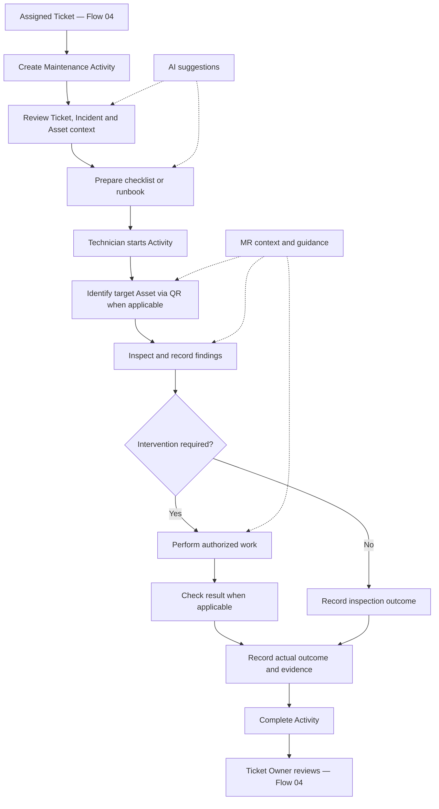
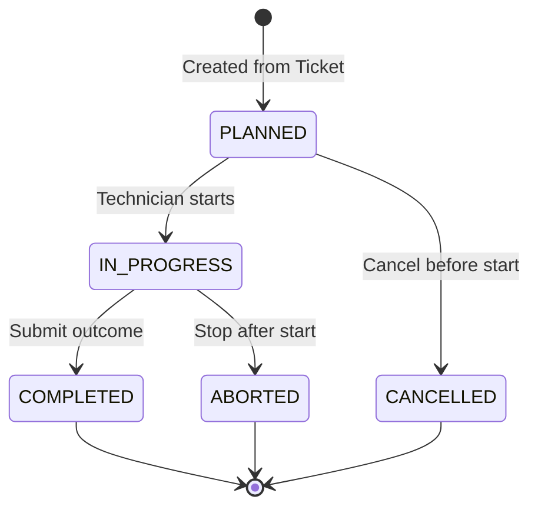

# Business Flow 05 — Ticket-driven Maintenance & AI/MR-assisted Support

> **Document type:** Shared business-flow baseline  
> **Status:** ACCEPTED — business baseline; Asset maintenance-state coordination pending integration design  
> **Domain:** Maintenance  
> **Primary actor:** Maintenance Technician  
> **Related flows:** Flow 01 — Infrastructure Asset Management; Flow 03 — Monitoring & Anomaly Detection; Flow 04 — Ticket Management

## 1. Purpose

Enable a Maintenance Technician to carry out and document ticket-driven maintenance on selected infrastructure assets in the AR-IMMS proof of concept (PoC). The flow supports reviewing operational context, preparing the work, inspecting assets, performing authorized interventions when needed, and recording actual outcomes. AI provides evidence-based recommendations; mixed reality (MR) provides field context and guidance.

This document specifies **business behavior**, not APIs, persistence collections, or a specific MR implementation. It does not require the technician to successfully recover a service before the maintenance work can be marked complete.

## 2. Business outcomes

- A valid Ticket can initiate a Maintenance Activity, with the Ticket's assignee responsible for the assigned field work.
- Technicians can review relevant Ticket, Incident (when linked), Asset, and monitoring context before acting.
- An Activity can cover multiple assets and can be **inspection-only** or include corrective work.
- Authorized work and any applicable result checks are documented with truthful outcomes and relevant evidence.
- MR assists asset identification and presents context or guided steps where available; AI assists investigation, checklist drafting, and runbook selection.
- Maintenance completion, Incident resolution, and Ticket closure remain **distinct decisions** owned by their respective domains.

## 3. Scope and boundaries

### 3.1 In scope — PoC baseline

- **Initiation:** Ticket-driven only; no independent preventive-maintenance schedule.
- **Work types:** Selected software and basic-infrastructure inspection or corrective tasks that the testbed can demonstrate.
- **Assets:** One Activity may be linked to multiple registered Assets.
- **Assignment:** Reuse the assignee of the source Ticket; do not build a parallel assignment lifecycle.
- **Preparation:** Review context, select a checklist/runbook template, or review an AI-drafted checklist before using it.
- **Field work:** Identify the target Asset using QR where applicable, inspect it, execute authorized actions if required, and record findings.
- **Results:** Check the result when relevant and practicable; record the actual outcome, including `UNRESOLVED` or partial success.
- **MR:** Contextual visualization and step guidance, with QR-assisted asset lookup/identification in applicable field scenarios.
- **AI:** Evidence-based investigation and recommendations; the technician remains accountable for execution and recorded results.
- **Traceability:** Record who performed material actions, when, against which Ticket/Assets, and the resulting notes or evidence.

### 3.2 Out of scope

- Preventive-maintenance scheduling or recurring plans.
- Production-scale change approval, safety-permit, SOP/MOP/EOP workflow engines, or complex dispatch scheduling.
- Physical component repair/replacement or precise 3D repair simulation.
- Autonomous AI execution, remediation, or automatic Ticket closure/Incident resolution.
- A mandatory standalone verification stage or a requirement that every Activity include corrective action.

## 4. Participants and ownership

| Participant | Responsibility |
| --- | --- |
| **Maintenance Technician** | Reviews assigned work, selects or reviews checklist guidance, inspects/acts, and submits findings and outcome. |
| **System Monitoring Operator** | Reviews the operational situation and, where authorized, assesses Incident resolution independently of Activity completion. |
| **Ticket Owner** | Reviews work outcome and decides whether to close or continue the Ticket under Flow 04. |
| **Maintenance (Core)** | Owns Maintenance Activity lifecycle and maintenance-related records and evidence references. |
| **Ticket Management (Flow 04)** | Owns Ticket lifecycle, owner/assignee, articles, and the linkage to the source Ticket; Zammad remains the Ticket source of truth. |
| **Asset & Topology (Flow 01)** | Owns canonical Asset identity, placement, QR mapping, and Asset lifecycle. |
| **Monitoring / Incident (Flow 03)** | Owns observed conditions, Incident evidence and resolution decisions. |
| **AI Investigation** | Suggests analyses, checklists and procedures; does not authorize or perform actions. |
| **MR client** | Presents field context and guidance; does not independently change business records or decide outcomes. |

## 5. Main business workflow

1. An authorized user starts a Maintenance Activity from an existing Ticket. The Activity references that Ticket and the relevant Assets.
2. The technician reviews Ticket details and any available Incident/monitoring evidence, affected-asset identity and location.
3. The technician prepares a suitable checklist or runbook. AI drafts are advisory and require human review before use.
4. The technician starts work, identifies the relevant Asset (QR where applicable), and records inspection findings.
5. If action is necessary, the technician performs only work they are authorized to execute. An inspection-only Activity may proceed directly to outcome recording.
6. Where applicable, the technician checks the operational result, records what was observed, and attaches relevant evidence.
7. The technician submits an outcome and completes the Activity. Ticket Owner review and any Incident resolution occur separately.

## 6. Maintenance Activity lifecycle

| State | Business meaning |
| --- | --- |
| `PLANNED` | Activity exists; context and guidance can be prepared, and work has not started. |
| `IN_PROGRESS` | Technician is inspecting and/or performing an authorized intervention. |
| `COMPLETED` | Work has ended and its actual outcome is recorded; this does **not** assert the underlying Incident is resolved. |
| `CANCELLED` | Activity is cancelled before work starts. |
| `ABORTED` | Work started but was stopped; the reason and any safety/operational concern are recorded. |

**Deliberate simplification:** Assignment is inherited from the Ticket. Inspection, QR identification, execution, and checking results are steps **within** `IN_PROGRESS`, not independent lifecycle states. There is no mandatory `VERIFYING` or `RESUME` state in the baseline.

## 7. Business rules

| ID | Rule |
| --- | --- |
| **BR-01** | An Activity originates from a valid Ticket. An Incident link is optional because a Ticket can exist without an Incident. |
| **BR-02** | The assigned technician follows the Ticket assignee; Maintenance does not independently own Ticket assignment. Access and execution follow applicable authorization. |
| **BR-03** | An Activity may reference multiple Assets; each recorded action/finding must identify its applicable target when relevant. |
| **BR-04** | A checklist may come from a template/runbook or an AI draft; a user reviews AI-generated steps before using them. |
| **BR-05** | Before a physical intervention, the technician confirms the intended Asset using available identifying information; QR is supported in applicable MR field scenarios, not required for every software-only task. |
| **BR-06** | Inspection-only work is valid; no corrective action is required for completion. |
| **BR-07** | Material work, observations, actions, and actual outcome are recorded. Evidence is attached where applicable and available; do not fabricate evidence. |
| **BR-08** | `COMPLETED` means the Activity ended, not that service recovery succeeded, the Incident is `RESOLVED`, or the Ticket is `CLOSED`. |
| **BR-09** | AI may analyze and propose but cannot approve, execute, or autonomously remediate. |
| **BR-10** | MR presents context and optional guidance; it does not authorize an operation, determine asset state, or decide success. |
| **BR-11** | Maintenance does not automatically resolve an Incident or close a Ticket. Those actions remain with Flow 03 and Flow 04. |
| **BR-12** | Asset lifecycle changes, if applicable, must go through the public Asset & Topology contract; Maintenance must not directly modify Asset storage. The coordination policy remains pending as described in §10. |
| **BR-13** | An Activity can be `ABORTED` when conditions prevent safe continuation. Record the reason and escalate to the relevant Operator/Ticket Owner rather than claiming completion. |

## 8. Logical records and evidence

| Concept | Business purpose |
| --- | --- |
| **Maintenance Activity** | Source Ticket, related Assets, performer, lifecycle and overall outcome. |
| **Inspection** | Checklist responses, observations and findings where used. |
| **Maintenance Record** | Actual steps/actions performed and their outcome. |
| **Verification / result-check record** | Optional identity confirmation or operational check, where applicable; not a mandatory state transition. |
| **Runbook Document** | Reference/metadata for an external procedure or guidance document. |
| **Evidence** | Relevant notes, photos, metrics, logs or references supporting recorded findings/outcome. |

These are **logical business concepts**, not a mandate to create a separate database collection for each.

## 9. Alternate and exception flows

| Situation | Expected behavior |
| --- | --- |
| Ticket is missing, invalid or access is denied | Reject Activity creation or access; do not create an orphaned Activity. |
| Ticket has no Incident | Activity may still proceed using the Ticket and relevant Asset context. |
| Technician determines no intervention is needed | Record inspection-only findings and outcome; Activity may be `COMPLETED`. |
| QR is unavailable or not applicable | Use an authorized alternative identification method as appropriate; do not pretend an unverified QR scan occurred. |
| Referenced Asset is ambiguous or differs from the intended target | Stop intervention until the target is clarified; record the discrepancy. |
| Suggested AI step is unsuitable or unsupported | Technician disregards or revises it; no automatic execution. |
| Recovery check fails or service remains degraded | Record `UNRESOLVED` or relevant outcome; do not auto-resolve Incident/close Ticket. |
| Work cannot continue safely | Transition `IN_PROGRESS → ABORTED`; record reason and notify/escalate through the work process. |
| Activity is cancelled before start | Transition `PLANNED → CANCELLED`; no execution is implied. |
| Monitoring data is missing | Record that the result cannot be confirmed; do not infer that the asset or service is healthy. |

## 10. Cross-flow coordination and unresolved design

### 10.1 Incident, Maintenance and Ticket are independent

| Event | Owning domain and effect |
| --- | --- |
| Technician completes work | Maintenance marks Activity `COMPLETED` with an outcome. |
| Monitoring indicates improvement | Monitoring supplies evidence, not an automatic maintenance outcome. |
| Operator confirms resolution | Flow 03 may mark Incident `RESOLVED` under its own policy. |
| Ticket Owner accepts closure | Flow 04 may mark Ticket `CLOSED`. |

### 10.2 Asset maintenance-state coordination — **PROPOSED, not accepted integration contract**

Flow 01 BR-14 previously referenced `EXECUTE`, `RESUME`, and `ABORT`. This Flow 05 baseline uses `PLANNED`, `IN_PROGRESS`, `COMPLETED`, `CANCELLED`, and `ABORTED`. The terminology and public coordination contract must be reconciled before implementation.

Proposed behavior, subject to Flow 01/05 joint design review:

- Starting work (`PLANNED → IN_PROGRESS`) may request `ACTIVE → MAINTENANCE` for affected Assets **when applicable**.
- Completion may request `MAINTENANCE → ACTIVE` only when no other Activity is executing on that Asset and operational policy permits it.
- Abort must **not** automatically signal that an Asset is safe or healthy. Record operational concerns and arrange the appropriate next action.
- Cancelling `PLANNED` work does not modify Asset lifecycle.
- All Asset transitions use the Asset & Topology public contract. Any concurrency, retry and authorization behavior belongs in the eventual integration design.

**Decision still needed:** whether every `IN_PROGRESS` Activity changes Asset lifecycle, or only those involving actual controlled intervention. Do not infer a mandatory transition from the state diagram alone.

## 11. Acceptance criteria

| ID | Acceptance scenario |
| --- | --- |
| **F5-AC-01** | Authorized user can create an Activity from a valid Ticket, retaining the source Ticket reference and assignee context. |
| **F5-AC-02** | The technician can review available Ticket, Asset and, if linked, Incident context. |
| **F5-AC-03** | A checklist/runbook can be selected or an AI draft reviewed before use. |
| **F5-AC-04** | The MR field scenario resolves the intended Asset through QR and displays its relevant context. |
| **F5-AC-05** | An Activity can cover multiple Assets and associate findings/actions with the relevant target. |
| **F5-AC-06** | Inspection-only work can be completed without performing corrective action. |
| **F5-AC-07** | The technician can record actions, findings, evidence where applicable, and an outcome including unresolved or partial recovery. |
| **F5-AC-08** | The lifecycle permits `PLANNED → IN_PROGRESS → COMPLETED`, cancellation before start and abort after start; no standalone verification state is required. |
| **F5-AC-09** | Completing an Activity does not automatically resolve an Incident or close the Ticket. |
| **F5-AC-10** | AI suggestions do not autonomously execute maintenance actions; authorized human action remains required. |
| **F5-AC-11** | MR guidance does not change Ticket, Incident or Asset state by itself. |
| **F5-AC-12** | Material actions and activity outcomes remain traceable to a user, time, Ticket and relevant Assets. |

## 12. Operational practice references and limitations

The workflow takes inspiration from established operations practices, but **does not claim formal conformity or certification**:

- **Uptime Institute — The Making of a Good Method of Procedure:** emphasizes preparing, controlling, and documenting procedures for operational work. [Reference](https://journal.uptimeinstitute.com/the-making-of-a-good-method-of-procedure/).
- **Uptime Institute — Operational Sustainability:** operational management and procedures support reliable data-center operation. [Reference](https://ats.uptimeinstitute.com/tier-certification/operations).
- **Google SRE — Managing Incidents:** separates operational incident coordination and execution responsibilities. [Reference](https://sre.google/sre-book/managing-incidents/).

The PoC applies the proportional principles of preparation, authorized execution, recorded outcome and human accountability, without implementing a full production data-center operations management framework.

## 13. Open implementation decisions

1. **Asset lifecycle coordination (Flow 01 BR-14):** when `IN_PROGRESS` should set `MAINTENANCE`, and the safe return/abort policy for overlapping activities.
2. **Activity outcome vocabulary:** exact allowed outcome values and how partial recovery is represented.
3. **Controlled service restart demo:** whether it is in the committed baseline and, if so, its authorization/execution boundary.
4. **MR navigation:** optional enhancement; do not make navigation a prerequisite for baseline Activity completion.
5. **Incident resolution policy:** Flow 03 Operator resolution is independent; define detailed resolution criteria in its owning flow/integration design.
