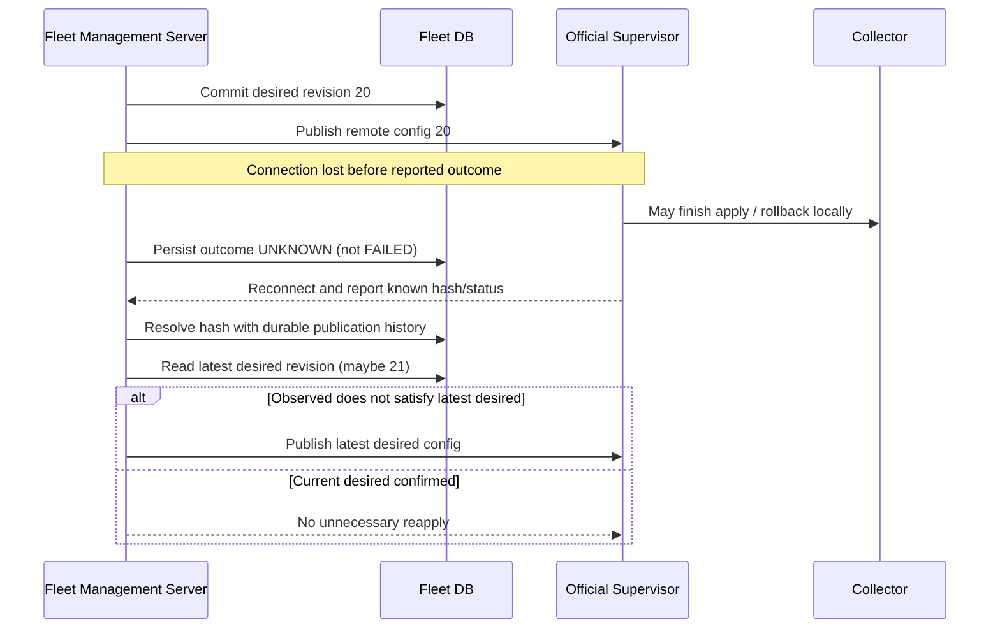

# C02 — Fleet Configuration Management (v1 draft)

**Status:** Core typed-intent boundary and Fleet authority **ACCEPTED**; intent kinds, schemas and merge/publication behavior **PROPOSED / OPEN**.  
**Parties:** Operator→Core, Core→Fleet Management Server (internal HTTPS), Fleet→official Supervisor (native OpAMP), Supervisor→Collector.  
**Owners:** Core = IAM/business authorization and business audit; Fleet = monitoring policy, desired revisions, rendering, publication, observed outcomes and execution audit; Supervisor = config composition/application/rollback; Collector = data plane.

## Responsibilities and state model

| Concern | Authoritative owner | Distinct value |
|---|---|---|
| Authorized request | Core | `operation_id`, actor/Node scope, business audit |
| Requested monitoring intent | Fleet | typed intent with target and revision precondition |
| Desired config | Fleet | `desired_revision` and canonical content/fingerprint |
| Publication | Fleet | `publication_id`, OpAMP remote hash, linked desired revision |
| Protocol status | Supervisor → Fleet | remote config hash/status reported by Supervisor |
| Effective config | Supervisor (when supported and observed) | merged effective config evidence, **not** necessarily same hash as remote config |
| Collector runtime health | Collector/Supervisor | process/readiness evidence |
| Telemetry delivery | Gateway/sink | OTLP reception evidence, not inferred from APPLIED |

**No Agent native-mode desired-config writer.** Agent supplies local bootstrap/managed dependency inputs; legacy Agent configuration/LKG are exclusive to legacy mode.

## Sequence: typed intent → publish → observed outcome

```mermaid
sequenceDiagram
    autonumber
    actor Operator
    participant Core
    participant Fleet as Fleet Management Server
    participant DB as Fleet DB
    participant Sup as Official OpAMP Supervisor
    participant Col as Collector
    Operator->>Core: Configure metrics for approved Node
    Core->>Core: Authenticate + authorize + business audit
    Core->>Fleet: Submit typed intent (idempotency, CAS, trusted actor)
    Fleet->>Fleet: Validate capability/target/endpoint
    Fleet->>DB: Atomic desired revision + operation + outbox intent
    Fleet-->>Core: 202 Accepted (operation_id, desired_revision)
    Fleet->>Fleet: Render stable config, validate against pinned components
    Fleet->>DB: Record publication hash/revision BEFORE send
    Fleet->>Sup: Native OpAMP RemoteConfig (hash)
    Sup->>Col: Merge/apply; restart if needed
    Sup-->>Fleet: Native RemoteConfigStatus (observed hash/status)
    Fleet->>DB: Map hash to publication/revision and store observation
    Core->>Fleet: Query operation outcome
    Fleet-->>Core: Desired vs published vs observed state
```

## Proposed Core→Fleet operation (NOT final OpenAPI)

`POST /internal/v1/fleet/configuration-intents`

```json
{
  "schema_version": 1,
  "operation_id": "c36e268a-e22a-4c27-bc48-6dc94579df2b",
  "target": {"agent_id": "bfbfe8c8-2bf5-4b77-86b0-29071c9ca1e5"},
  "expected_revision": 12,
  "intent": {
    "kind": "PROMETHEUS_SCRAPE",
    "action": "UPSERT",
    "resource_key": "service/redis-01",
    "settings": {"endpoint": "redis-exporter:9121", "interval_seconds": 15}
  }
}
```

**Kind candidates, not yet approved:** `PROMETHEUS_SCRAPE`, `OTEL_RECEIVER`, `OTLP_GATEWAY`. Typed intent avoids arbitrary untrusted YAML from Core. Future receiver-specific settings require schema/allowlist validation, credential references, SSRF-aware endpoint policy, and pinned Collector component availability checks.

### Proposed 202 response

```json
{
  "schema_version": 1,
  "operation_id": "c36e268a-e22a-4c27-bc48-6dc94579df2b",
  "target_agent_id": "bfbfe8c8-2bf5-4b77-86b0-29071c9ca1e5",
  "desired_revision": 13,
  "operation_status": "ACCEPTED"
}
```

### Proposed query projection

```json
{
  "desired_revision": 13,
  "published_revision": 13,
  "published_remote_hash": "opaque-hash",
  "observed_applied_revision": 12,
  "observed_remote_hash": "older-hash",
  "observation_status": "RECOVERED_PREVIOUS",
  "evidence_time": "2026-11-18T02:00:00Z",
  "collector_readiness": "UNKNOWN",
  "otlp_delivery": "UNKNOWN"
}
```

**Important:** `RECOVERED_PREVIOUS` is an **AR-IMMS projection**, **not** an OpAMP standard status enum. Map only observed protocol fields and verified publication/hash records. Actual Supervisor automatic rollback may report APPLIED for previous working config; do not mislabel desired 13 as applied.

## Config composition and ownership contract

```text
Agent local file:     bootstrap / dependency discovery inputs / safe fallback
Fleet remote fragment: monitoring intent and centrally managed Collector components
Supervisor:          pinned actual merge semantics using local + $REMOTE_CONFIG
Collector:           validate/start receivers and export
```

This boundary is **OPEN until exact v0.160.0 merge tests**. Do not assume YAML dictionary merge, list concatenation, duplicate-key behavior or component precedence. In particular, if both local/remote fragments define `service.pipelines.metrics`, the result must be verified. Namespaced component IDs and explicit component/pipeline ownership are required. Protected credentials and Supervisor transport settings must never be overridden by arbitrary remote Collector config.

**Dependency safety:** Agent owns Windows Exporter/LHM/Node Exporter install/teardown. Fleet config may scrape their endpoints; Agent must not uninstall a dependency still referenced by live/fallback/legacy Collector config. The exact cross-system safe-teardown coordination is **OPEN**.

## Offline, reconnection and rollback



- Outbox-style wakeup may push to connected Supervisor. A missed event or Fleet restart **must not lose** the latest config: reconnect and periodic/resume reconciliation read persisted desired state.
- Failed/missing report is not proof apply failed; record UNKNOWN with evidence freshness.
- Never report revision 20 applied solely because a connection was alive or Collector was ready.
- Invalid remote config: Supervisor's actual pinned rollback behavior determines observation. Fleet preserves **latest desired** separately from **last observed working**. Policy for repeatedly retrying a known-bad desired revision is **OPEN**; avoid restart loops.
- Same `operation_id`+same canonical request yields same result; different fingerprint yields conflict. CAS rejects stale `expected_revision`; no-op updates should not churn Collector unnecessarily.
- Fleet must persist publication mapping before sending; hashes/bytes require a defined canonicalization strategy and version.

## Proposed internal operations

| Operation | Semantics | Required safeguards |
|---|---|---|
| Submit intent | Validated authorized command, async `202` | service-to-service auth, actor/target scope, idempotency, CAS |
| Read current desired | Returns Fleet authoritative version | consistent read / version |
| Read publication/operation outcome | Distinguishes accepted/published/observed | provenance, freshness; status not fabricated |
| Dry-run validation | Optional draft | pinned component manifest and safe endpoint validation |

## Audit and security

Core stores actor decision and `operation_id`; Fleet stores desired revision admission, publication and observed outcomes with matching ID. Do not copy raw secrets/full configuration into general audit. Treat endpoints and receiver settings as privileged input (SSRF, arbitrary connection, credential references). No blind acceptance of client `actor_id` without verifiable Core authorization context.

## Acceptance gates

- Two concurrent commands with same `expected_revision`: one succeeds; stale command conflicts.
- Duplicate `operation_id` stable; changed body conflicts; no-op does not restart unnecessarily.
- New desired revision reaches **already connected** Supervisor, not only on reconnection.
- Fleet restart while send pending does not lose intent; reconnect with old hash sees latest desired.
- Bad config rollback accurately reports last observed working hash/revision and does not claim latest desired applied.
- Collector actual OTLP sink E2E distinct from protocol APPLIED.
- One native-mode Collector lifecycle owner; no duplicate scrape from local and remote receivers.

## OPEN decisions (block wire or implementation detail)

- F01: exact typed intent kinds, versioned per-kind schemas, security/target endpoint policy, supported receiver capability catalog.
- F02: component ownership and local/remote merge precedence under pinned Supervisor v0.160.0; avoid duplicate pipelines.
- F03: effective config reporting/redaction and meaning of hash, remote content canonicalization, collision/duplicate publication policy.
- F04: live-update event source (Core→Fleet) and push mechanism to connected WSS sessions; persistent reconciliation trigger.
- F05: failed-desired retry/backoff/quarantine and rollback acknowledgement semantics.
- F06: exporter dependency endpoint discovery and safe uninstall when config reference is central; offline policy.
- F07: trusted Core→Fleet actor delegation/service authentication, exact paths and error codes; audit/outbox and retention.
