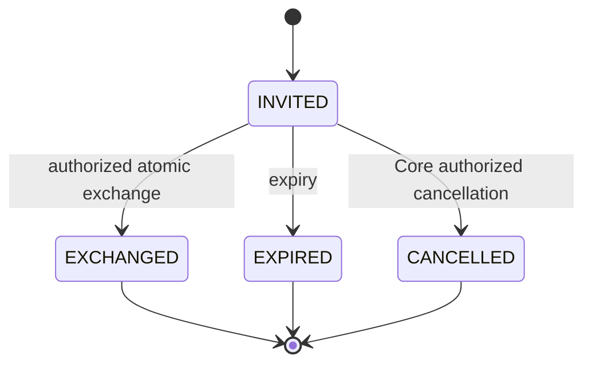

# C01 — Enrollment, Installation Identity & Credential Lifecycle (v1 draft)

**Status:** Architecture accepted; endpoint/schema/security details **PROPOSED / OPEN**.  
**Parties:** Operator→Core (public), Core→Fleet (trusted internal HTTPS), Agent→Fleet (enrollment HTTPS), official Supervisor→Fleet (native OpAMP WSS).  
**Owners:** Core owns IAM/Node authorization and Node registry; **Fleet Management Server** owns invitation, registration, installation credential/revocation and OpAMP session authorization; Agent owns local `agent_id`, enrollment attempt recovery and protected secrets.

## Contract boundaries

| Interaction | Initiator → Receiver | Intent | Authority |
|---|---|---|---|
| Create invitation | Core → Fleet | Preapprove one installation for an existing authorized `node_id` | Core authorizes actor/Node; Fleet validates trusted request and creates bounded invitation |
| Exchange invitation | Agent → Fleet | Bind stable installation UUID with invitation, obtain credential | Fleet validates invitation/attempt and binding; evidence is **not** authentication |
| Recover lost response | Agent → Fleet | Resume **same** enrollment attempt without a new credential | Fleet persisted attempt/result; proof of same attempt required |
| OpAMP session | Official Supervisor → Fleet | Authenticated OpAMP connection | Fleet validates credential, binds actual `instance_uid` to authorized agent installation |
| Revoke / rotate | Core → Fleet; Agent/Supervisor observes effect | Disable credential/session or replace it | Core business authorization; Fleet credential/session authority; local Agent protected-store updates |

## Proposal: enrollment and connection sequence

```mermaid
sequenceDiagram
    autonumber
    actor Admin
    participant Core
    participant Fleet as Fleet Management Server
    participant DB as Fleet DB
    participant Agent as Telemetry Agent
    participant Sup as Official OpAMP Supervisor
    Admin->>Core: Approve registration for Node
    Core->>Core: IAM + Node eligibility
    Core->>Fleet: Create invitation (trusted actor, Node, idempotency)
    Fleet->>DB: Persist token hash, Node binding, expiry
    Fleet-->>Core: Invitation ID + one-time token (only on creation)
    Core-->>Admin: Secure installation instructions
    Agent->>Agent: Load persisted agent_id + collect host evidence
    Agent->>Fleet: Exchange token + agent_id + attempt_id
    Fleet->>DB: Atomic consume/bind; persist recoverable result
    Fleet-->>Agent: Protected credential + OpAMP endpoint
    Agent->>Agent: Save credential in OS protected store
    Agent->>Sup: Provision token reference + Supervisor config
    Sup->>Fleet: Authenticated OpAMP over WSS
    Fleet->>DB: Bind instance_uid to authenticated installation
    Fleet-->>Sup: Session established
```

## Illustrative operations (paths are **not approved**)

| Method / path | Caller | Result shape | Semantics |
|---|---|---|---|
| `POST /internal/v1/enrollment-invitations` | Core | `201` invitation reference + one-time secret | Core-authenticated authorized Node; audit creation; no generic Fleet public UI |
| `POST /v1/enrollments/exchange` | Agent | `200/201` enrollment result | Invitation exchange with durable `enrollment_attempt_id` |
| `POST /v1/enrollments/recover` | Agent | `200` same outcome or nonsecret terminal error | Requires attempt-specific recovery proof; **not** bare UUID lookup |
| `POST /internal/v1/installations/{agent_id}/revoke` | Core | `202` or confirmed revocation record | Persist revoke **before** disconnecting live sessions |
| `POST /internal/v1/installations/{agent_id}/rotate` | Core | operation reference | **Open** how new secret is securely conveyed to currently online Agent |

### Example: trusted invitation request

```json
{
  "schema_version": 1,
  "operation_id": "f89de94e-b08a-4e96-a7b0-c0f955f594ef",
  "node_id": "core-asset-node-id",
  "requested_ttl_seconds": 600
}
```

Actor identity **MUST** be derived from authenticated Core service context or a verified delegated actor assertion; the Fleet must not authorize based on a caller-supplied `requested_by` string.

### Example: invitation exchange

```json
{
  "schema_version": 1,
  "enrollment_attempt_id": "fc555a2f-b6d1-4b0e-9d14-76c5cfdc385e",
  "agent_id": "bfbfe8c8-2bf5-4b77-86b0-29071c9ca1e5",
  "invitation_token": "REDACTED",
  "identity_evidence": {
    "host_id": "opaque-host-identifier",
    "compute_type": "VM",
    "orchestrator": "NONE",
    "deployment_scope": "HOST_SERVICE"
  }
}
```

### Example: enrollment result (secret-bearing; never log)

```json
{
  "schema_version": 1,
  "agent_id": "bfbfe8c8-2bf5-4b77-86b0-29071c9ca1e5",
  "node_id": "core-asset-node-id",
  "credential_id": "credential-reference",
  "credential": "REDACTED",
  "opamp_endpoint": "wss://fleet.example.net/opamp",
  "credential_expires_at": null
}
```

The remote Agent enrollment endpoint and Supervisor OpAMP WSS endpoint are **different transports**. A credential that authenticates Supervisor need not automatically authorize every Agent reporting API: scope and audience are **OPEN**.

## Identity rules

- `agent_id`: **reuse existing persisted installation UUID**. Stable across reboot/upgrade; not a secret.
- `host_id`: derived opaque OS/machine identity evidence, **not** a login secret, binding proof, hardware serial or guaranteed physical identity.
- `host_type`: derived `BARE_METAL | VM | KUBERNETES | UNKNOWN` display field; independently store `compute_type: BARE_METAL | VM | UNKNOWN`, `orchestrator: NONE | KUBERNETES | UNKNOWN`, `deployment_scope: HOST_SERVICE | K8S_NODE_AGENT | K8S_POD | UNKNOWN`.
- Fleet must handle cloned VM with duplicate `host_id` but distinct `agent_id`: flag collision, never auto-merge, never authorize on fingerprint alone.
- Official Supervisor `instance_uid` is a **protocol ID**, not auth. Fleet binds it against the authenticated installation; mapping equality with Agent UUID is **not approved** until proven against pinned runtime.
- Core owns confirmed Node binding and topology relationships; Fleet records its authorized link and observed evidence but cannot unilaterally invent physical placement.

## Invitation / installation state



Invitation lifecycle is separate from installation state (`ACTIVE`, `REVOKED`, or `SUSPENDED` if later approved). No `PENDING_APPROVAL` in baseline: creating invitation **is** the approval.

## Retry, idempotency and failure semantics

| Situation | Required rule |
|---|---|
| Response lost after Fleet commits exchange | Same attempt + authenticated recovery proof returns **same credential/result**, not a second issuance; storage/recovery window **OPEN**, 24h suggested from legacy behavior |
| Invitation token replay with different attempt/agent | Reject; no second registration |
| Duplicate attempt with different request body | Conflict, do not rebind silently |
| Token expired/cancelled | Permanent rejection; response must not disclose whether target exists |
| Fleet/Core unreachable | Retry only transport/5xx/429 conditions with bounded backoff; don't erase prior protected credential |
| Agent reinstall | Do not silently change identity/binding; documented explicit recovery/re-enrollment required |
| Core authorization changes mid-enrollment | Fleet must have a defined atomic Node authorization snapshot/expiry or revalidation policy (**OPEN**) |
| Revoke online | Commit REVOKED, invalidate all relevant credentials, close matching OpAMP sessions, reject reconnect; no automatic Collector kill is implied |
| Concurrent revoke/publish | Publication and session authorization check must not allow post-revoke config delivery; race policy needs deterministic test |

**Security:** hash invitation secrets at rest; protect sensitive results/escrow; ensure replay-safe, rate-limited exchange; protect credential store on Windows/Linux; redact tokens from URLs, logs, error messages, Mongo audit and CLI. TLS/WSS mandatory off-loopback. Rotation may require separate control to deliver new secret—do **not** treat OpAMP package or command support as generic rotation executor.

## Acceptance gates

- Preapproved invitation can be exchanged exactly once; same-attempt recovery does not double-issue.
- Persisted old Agent UUID is reused; existing Core-enrolled installation migration is explicitly handled or safely left on legacy contract.
- Distinct `agent_id` sharing `host_id` is detected but not silently merged.
- Supervisor authenticates with protected credential; `instance_uid` binding occurs only after auth.
- Revocation while online invalidates active session and future reconnect; Collector behavior is separately documented.
- Windows/Linux credential protections and no-secret logs pass local tests.

## OPEN decisions (block wire approval)

- E01: enrollment exchange authentication/resumption proof and 24h recovery retention; token escrow encryption and cleanup.
- E02: exact token TTL/format, requested idempotency retention, rate limits and loss-of-reply semantics.
- E03: how Fleet verifies Core Node authorization at invitation time and concurrent Node retirement/unassignment semantics.
- E04: credential scopes/audiences for Agent HTTPS vs Supervisor WSS; rotation delivery and key rollover.
- E05: stable `instance_uid` configuration and mapping tested against Supervisor v0.160.0.
- E06: migration of already Core-enrolled installations and compatibility with `--core-origin` CLI.
- E07: exact endpoint paths, status/error codes, request/response field types and auth transport (OpenAPI pending).
