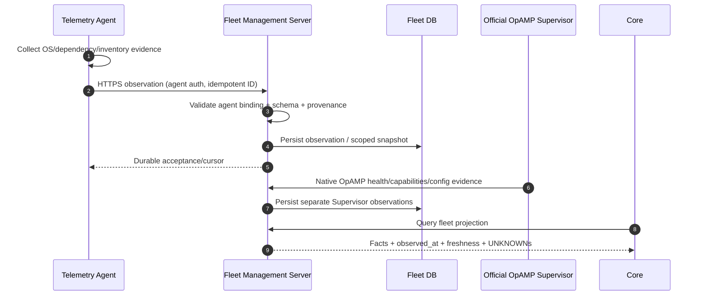

# C03 — Agent Identity, Inventory, Capabilities & Health Observations (v1 draft)

**Status:** Agent→Fleet **authenticated HTTPS REST accepted**; message fields, cadence, authentication and state projection **PROPOSED / OPEN**.  
**Owners:** Agent owns local evidence generation and source completeness; **Fleet Manager** stores fleet observations/freshness; **Core** owns verified Asset/Topology; **Official OpAMP Supervisor** reports its own protocol/runtime status directly to Fleet.

## Never confuse these data types

| Kind | Source | What it may prove | What it does NOT prove |
|---|---|---|---|
| `HOST_IDENTITY` | Agent OS/virtualization/K8s evidence | How local environment presents itself | Asset ownership, physical parent, authenticated identity |
| `RESOURCE_INVENTORY` | Agent provider or well-defined OTel metadata adapter | Resource observations scoped to provider and snapshot | Empty resources on provider failure; confirmed Core topology |
| `DEPENDENCY_STATUS` | Agent managed dependency manager | OS exporter install/config/health evidence | Collector configured or scrape successful |
| `AGENT_HEALTH` | Agent local diagnostics | Agent/process/credential/store condition | Supervisor configuration success or OTLP delivery |
| `AGENT_CAPABILITIES` | Agent version/feature catalog | Local ability to operate/manage host dependencies | Upstream Supervisor capability flags |
| Supervisor native OpAMP reports | **Official Supervisor→Fleet** | Supported OpAMP capabilities, protocol health, remote status | Full Agent inventory and product delivery health |
| Collector/OTLP telemetry | Collector→Gateway | Receivers/processors/export evidence where measured | Authorized business asset binding |

## Proposal: versioned observation envelope

```json
{
  "schema_version": 1,
  "agent_id": "bfbfe8c8-2bf5-4b77-86b0-29071c9ca1e5",
  "observation_id": "0eb11752-4b87-4687-8416-d9ac19ca5d95",
  "kind": "HOST_IDENTITY",
  "observed_at": "2026-11-18T02:00:00Z",
  "payload": {
    "host_id": "opaque-derived-identifier",
    "host_type": "KUBERNETES",
    "compute_type": "VM",
    "orchestrator": "KUBERNETES",
    "deployment_scope": "K8S_NODE_AGENT",
    "hostname": "worker-01",
    "os_type": "linux",
    "os_version": "Ubuntu 24.04",
    "architecture": "amd64",
    "agent_version": "0.1.4a",
    "virtualization_vendor": "KVM",
    "k8s_cluster_uid": null,
    "k8s_node_uid": null
  },
  "evidence": {
    "confidence": "INFERRED",
    "sources": ["os-machine-id", "dmi-hypervisor", "kubernetes-node-evidence"]
  }
}
```

Example contains *illustrative* values, not fabricated detections or final field requirements. `host_type` is a derived display convenience: `KUBERNETES` may coexist with `compute_type=VM`. `UNKNOWN` must be expressible at every ambiguous layer. Evidence should carry source, timestamp, extraction permission failures and confidence; trust should be evaluated server-side, not simply believed because Agent claims `VERIFIED`.

### Proposed transport

`POST /v1/agent-observations` with installation-scoped HTTPS authentication; Fleet validates authenticated principal's `agent_id`, schema/version, timestamp skew, payload bounds and authorization to report each kind. Return `202/200` only after durable accept, or explicit retryable failure. Endpoint and auth details **OPEN**. An OpAMP bearer token is not necessarily authorized for reporting endpoints by default.

## Inventory snapshot semantics

Proposed `RESOURCE_INVENTORY` payload:

```json
{
  "provider_id": "docker/local-engine",
  "snapshot_id": "e0a7ad08-17da-490e-962e-5c310b0d7d1c",
  "scope": "engine/local",
  "completeness": "COMPLETE",
  "observed_at": "2026-11-18T02:00:00Z",
  "resources": [
    {
      "source_native_id": "container-immutable-id",
      "kind": "CONTAINER",
      "attributes": {"image": "redis:7"}
    }
  ]
}
```

- `COMPLETE`: Fleet may mark resources absent **only within the same authenticated provider+scope**, and only after durable snapshot reconciliation with a monotonically ordered snapshot cursor/sequence (**OPEN**).
- `PARTIAL`: only upsert reported resources; **no absence-based deletion**.
- `FAILED`: error evidence; **never transform into an empty COMPLETE snapshot**.
- Snapshot IDs are idempotent. Out-of-order older complete snapshots must not delete newer resources. Stable source-native IDs must be provider scoped; hostnames and IPs are labels, not global identities.
- Local Agent inventory/history can remain available offline; central Fleet is an observation projection, not a replacement for OS-side safety records.

## Reporting and freshness sequence



## Agent and Supervisor capability separation

Agent capabilities may include `managed_dependencies` (`windows_exporter`, `libre_hardware_monitor`, `node_exporter`), `docker_inventory`, `typed_operations` and version/OS permissions. Supervisor capabilities should be sourced from its actual OpAMP reports/config on the pinned version (e.g., remote config, effective config, rollback behavior). Collector component availability comes from the pinned distribution manifest, not Agent self-reported support for arbitrary receiver names. Don't merge all three into a boolean `capabilities` list without source.

## Health projection model (PROPOSED)

```text
agent_process:       HEALTHY | UNHEALTHY | UNKNOWN
supervisor_session:  CONNECTED | DISCONNECTED | UNKNOWN
collector_readiness: READY | NOT_READY | UNKNOWN
config_observation:  APPLIED_CURRENT | APPLIED_OLDER | FAILED | UNKNOWN
collection_evidence: PRESENT | ABSENT | UNKNOWN
delivery_evidence:   PRESENT | ABSENT | UNKNOWN
```

Never mark `delivery_evidence=PRESENT` because a heartbeat is present or Collector `/health` returns 200. Distinguish `ABSENT` (measured failure) from `UNKNOWN` (no measurement/stale data). Projection needs evidence source, `observed_at`, receipt time and expiry policy.

## Retry, replay and security

- Agent buffers **boundedly** when Fleet unavailable; retain local operational evidence where already durable, but do not assert exactly-once network delivery. Storage cap/eviction and replay order are **OPEN**.
- Deduplicate by authenticated `agent_id` + `observation_id` (or provider+snapshot cursor) without removing newer facts because old requests retry.
- Reject impossible timestamps/oversized payloads/unauthorized kinds with stable nonsecret errors; distinguish unsupported schema vs temporary Fleet outage.
- Minimize machine identifiers, IPs, hardware serials, sensitive process/container env, tokens and raw full configs; redact and restrict retention.
- Collector/OTel resource attributes should reuse OpenTelemetry semantic conventions (`host.id`, Kubernetes resource attributes, `container.id`) where meaningful, but business Node ID is a separate authorized mapping.

## Acceptance gates

- Agent's persisted UUID reused as `agent_id`; duplicate machine fingerprints do not merge Agent records.
- Detect bare metal, VM and Kubernetes contexts with conflicting/missing evidence resolved to UNKNOWN, not a false physical placement.
- COMPLETE/PARTIAL/FAILED inventory snapshots and out-of-order/retry handling preserve live resources.
- Windows Exporter/LHM/Node Exporter status remains locally available during Fleet outage and CLI remains compatible.
- Supervisor reporting does not duplicate Agent payload; readiness and OTLP evidence remain separate.
- Secret redaction, bounded payload, authenticated scope, and stale evidence behavior tested.

## OPEN decisions

- H01: exact API route/auth scopes; same or separate credential from Supervisor; token rotation interaction.
- H02: observations per request vs batch, ordering cursor, size cap, schedule, retry/retention policy.
- H03: inventory provider/scope uniqueness, snapshot clock, COMPLETE replacement algorithm and history retention.
- H04: host fingerprint derivation/privacy/hash salt scope; OS-specific detection source evidence and clone conflict policy.
- H05: explicit Node UID, physical/VM parent and Kubernetes metadata mapping to Core topology with provenance.
- H06: fleet projections/status enums, evidence expiry and delivery verification source.
