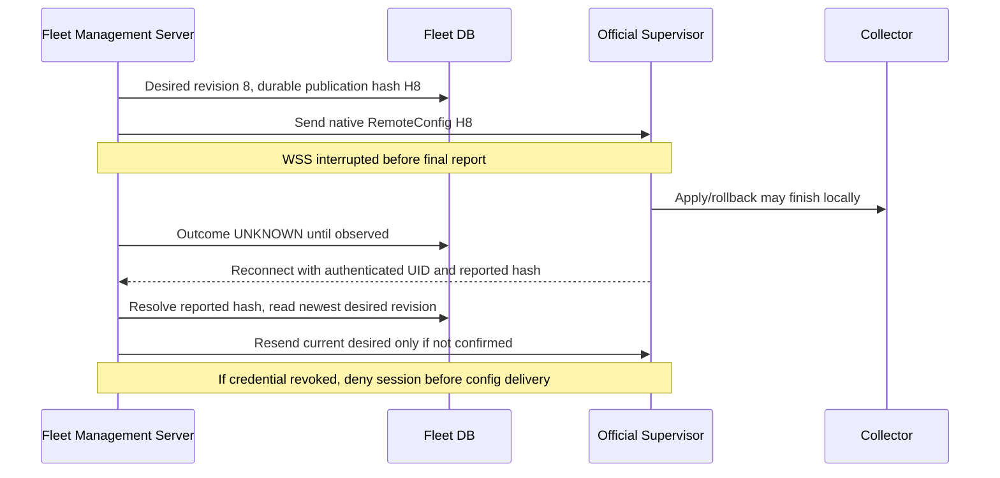

# C04 — OpAMP Integration Profile: Fleet Manager ↔ Official Supervisor (v1 draft)

**Status:** Architecture boundary **ACCEPTED**, pinned-runtime and mapping details **PROPOSED / TEST REQUIRED**.  
**Protocol:** Unmodified native **OpAMP** over WSS (upstream spec); not an AR-IMMS REST/JSON protocol.  
**Server:** AR-IMMS **Fleet Management Server**, our Go product using `opamp-go`; central fleet policy/persistence/session owner.  
**Client:** **Official OpenTelemetry OpAMP Supervisor**, upstream executable pinned `cmd/opampsupervisor/v0.160.0`; per-host Collector process/config executor.  
**Do not conflate** with the Agent repository's transitional `internal/opampserver` adapter or legacy Agent Collector process supervisor.

## Wire-profile ownership

| Concern | Fleet Manager | Official Supervisor | Agent |
|---|---|---|---|
| WSS endpoint | Serve and authorize | Connect and reconnect | Provision endpoint in protected Supervisor config |
| Credentials | Issue/revoke, authenticate sessions | Supply credential via supported extension | Store/provision protected token and handle credential reference updates |
| Instance UID | Persist verified binding to `agent_id` | Sends OpAMP instance identity | Retains stable installation UUID; never treats UID as auth |
| Desired Collector policy | Durable revision + published hash | Receive remote config | No second fleet-authoritative native writer |
| Config apply/rollback | Attribute observed hash/status | Merge/apply/restart Collector; automatic startup rollback | Startup/fallback provisioning, local evidence and process containment |
| Effective config/health/capabilities | Consume/report only what pinned Supervisor actually sends | Report when enabled/supported | Keep own product health and inventory distinct |
| Restart Collector command | Explicitly deferred baseline | Supported upstream but **disabled by default** in current AR-IMMS config | Does not repurpose OpAMP restart for host/container Operations |
| Collector packages/update | Do not advertise | Not fully implemented in pinned release | Artifact bootstrap/OS upgrade remain local responsibility |

## Pinned v0.160.0 capability profile

Based on provided P0 audit at `c9597df`; **not a new live test**:

| Capability | Upstream pinned default | AR-IMMS generated config | Baseline decision |
|---|---|---|---|
| `accepts_remote_config` | false | true | Required |
| `reports_remote_config` | false | true | Required |
| `reports_effective_config` | true | omitted (default applies) | Optional evidence; runtime payload unverified |
| `accepts_restart_command` | false | omitted/disabled | Explicitly disabled |
| Own metrics | true | omitted | No implied Fleet ingestion |
| Own logs/traces | false | omitted | Disabled |
| Health reporting | true | omitted | Do not equate with Collector/OTLP delivery |
| Startup fallback | supported, configured | local Collector config | Required, scoped to tested behavior |
| Automatic config rollback | false | true | Required; exact failure cases need tests |
| Package/binary updates | incomplete/unsupported | not configured | Deferred |

Exact pinned source references:
- [Supervisor README](https://github.com/open-telemetry/opentelemetry-collector-contrib/tree/cmd/opampsupervisor/v0.160.0/cmd/opampsupervisor)
- [Supervisor config defaults](https://github.com/open-telemetry/opentelemetry-collector-contrib/blob/cmd/opampsupervisor/v0.160.0/cmd/opampsupervisor/supervisor/config/config.go)
- [OpAMP specification](https://opentelemetry.io/docs/specs/opamp/)

Don't assert that `CustomMessage` support equals a general-purpose command executor. Existing AR-IMMS NATS Operations remain separate.

## Connection, publication and evidence flow

```mermaid
sequenceDiagram
    autonumber
    participant Agent as Telemetry Agent
    participant Sup as Official OpAMP Supervisor
    participant Fleet as Fleet Management Server
    participant DB as Fleet DB
    participant Col as OTel Collector
    Agent->>Sup: Provision pinned runtime, token and local fallback
    Sup->>Fleet: WSS OpAMP hello + authenticated bearer + instance_uid
    Fleet->>DB: Resolve credential, authorized installation, UID binding
    Fleet-->>Sup: Authenticated session + current remote config if required
    Fleet->>DB: Persist rendered remote hash/revision publication
    Fleet->>Sup: Native RemoteConfig + hash
    Sup->>Col: Merge and apply; Collector lifecycle managed here
    Sup-->>Fleet: RemoteConfigStatus + actual reported hash
    Fleet->>DB: Resolve reported hash to durable publication and revision
```

The exact order of initial Hello/config exchange is governed by the native OpAMP protocol. Diagram expresses application-level obligations, not a claim about specific protobuf frame ordering. **Persist publication BEFORE send** also applies when sending with the initial server response.

## Config and status invariants

- Identity/session: authenticate credential first; bind `instance_uid` only to authenticated `agent_id` using a controlled mapping. Duplicate UID across active unauthorized installations is a conflict, never silently remapped.
- `agent_id` and `instance_uid` are separate identifiers. **PROPOSED implementation rule:** bind the first 16-byte UID only after credential verification; a reconnect must use that same UID. A changed UID conflicts; remapping is never implicit.
- **PROPOSED implementation rule:** keep credential status and the optional UID on the same installation record. Conditional single-document binding and revocation updates provide an atomic order without a multi-document transaction. The callback checks status and UID for every message. A revoke that wins first denies the callback; a callback authorized before revocation may finish, and subsequent callbacks are denied. Immediate asynchronous socket termination remains an OPEN enforcement choice.
- **VERIFIED LOCALLY AND IN HOSTED CI:** official Supervisor v0.160.0 kept its UID after restart with the same state directory and generated a different UID with a fresh directory. Hosted Ubuntu and Windows UID-continuity checks passed; reinstall, upgrade, and other state-loss behavior remain OPEN and are not inferred from the OpAMP UID field.
- **PROPOSED recovery policy:** no automatic UID replacement after continuity loss. A future recovery operation must have separate authorization, audit, and an expected-current-UID condition. Such an operation is not implemented.
- Remote configuration bytes/content hash are protocol fields; Fleet desired revision is **not** a protocol-provided revision. Persist immutable association of config hash and Fleet revision/publication ID. Canonicalization must match actual bytes sent.
- `APPLIED` for an old hash **is not** latest desired applied. Unknown/unpublished hashes remain UNATTRIBUTED, not inferred from current desired.
- Supervisor `automatic_config_rollback` only covers behavior actually supported by pinned executable; Fleet must not pretend successful startup rollback proves delivery or all runtime fault recovery.
- Supervisor's effective config may contain secrets and can differ from remote config. If consumed, apply redaction, access controls, size/retention limits and distinguish its hash from remote hash.
- Local `config_files` plus `$REMOTE_CONFIG` composition must be tested against pinned binary for real component ID/pipeline collisions. `startup_fallback_configs` is a standalone fallback, **not just another merged config**.
- Native mode has **one Collector process owner**: Official Supervisor. Agent may supervise/contain Supervisor at OS process level but does not independently manipulate the Collector process or remote config.

## Reconnect during apply / failure / revocation



- Connected-session config updates require a live notification/wakeup path in Fleet Management plus retry/reconciliation. `opamp-go` does not automatically watch the Core/Fleet database.
- Core outage and Fleet outage are distinct. Local Collector may continue under last-working config, subject to explicit policy and pinned behavior.
- Revocation commits first, closes matching WSS sessions and prevents future reconnect or policy delivery. It does **not automatically mean stop the Collector**. Exact live-session race and bounded enforcement required.
- `accepted`, `published`, `reported applied`, `effective`, `Collector ready`, and `OTLP delivered` must remain distinguishable.

## Minimal tests

1. Authenticated WSS + stable UID mapping; wrong binding and revoked credentials rejected.
2. Remote config updates while Supervisor remains connected; unchanged config no-op.
3. Local/remote merge with component name/pipeline conflict; verify effective applied config.
4. Disconnect between publication/apply/ack, restart Fleet, reconnect and resolve latest desired.
5. Invalid config rollback with old hash attribution and restored Collector running.
6. Credential revoke during active connection; no future config sent, reconnect rejected.
7. Single managed Collector process, actual OTLP sink delivery, Windows and Ubuntu paths where test infrastructure permits.

## OPEN decisions

- O01: exact Supervisor instance UID provisioning/mapping behavior pinned v0.160.0.
- O02: Fleet `opamp-go` active-session push design and race behavior across reconnect/restart.
- O03: remote config bytes/hash canonicalization; actual effective config report capture and redaction.
- O04: local/remote/fallback merge contract and owner namespacing, invalid config rollback scope.
- O05: credential scope/rotation and revocation timing with existing online sessions; fallback during Fleet outage.
- O06: exact Fleet session/auth persistence design and cross-system API credentials (outside protocol).

## Fleet Manager identity implementation proposal (2026-11-21; not contract approval)

The Fleet branch now contains Mongo-backed credential digest verification, one-time UID pinning, and `Application.Run` wiring for the OpAMP callback adapter and listener. `OPAMP_ENABLED` defaults to false; when enabled, startup still requires the Mongo verifier and mandatory authenticated callbacks, and non-loopback listeners require TLS. Credential provisioning/revocation endpoints, Core authorization, token expiry and rotation, and recovery/rebinding operations are not present, so production deployments must keep the listener disabled until those security prerequisites and C01/C04 decisions are resolved. Hosted UID continuity, Mongo binding/revocation, Ubuntu/Windows Go tests, and quality checks passed. A new application-level Mongo plus pinned Supervisor test passed locally under the race detector and covers actual `Application.Run` startup, readiness, authenticated UID binding, shutdown, listener-bind failure cleanup, and index-conflict startup failure. Hosted CI for this test remains pending. Neither test approves an automatic recovery/rebind policy.
